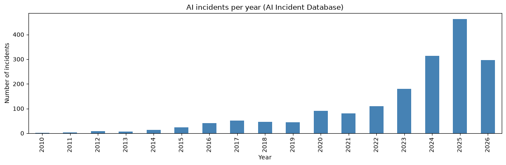
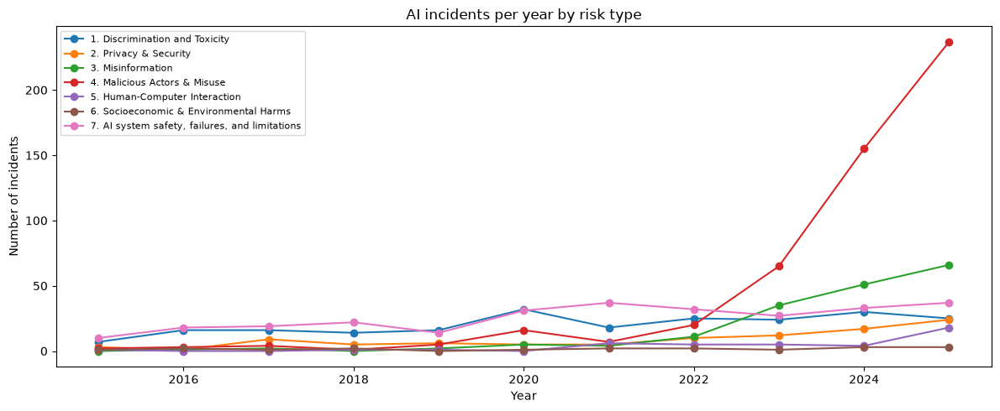
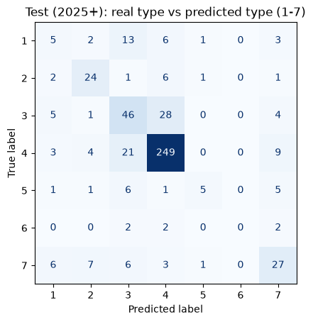
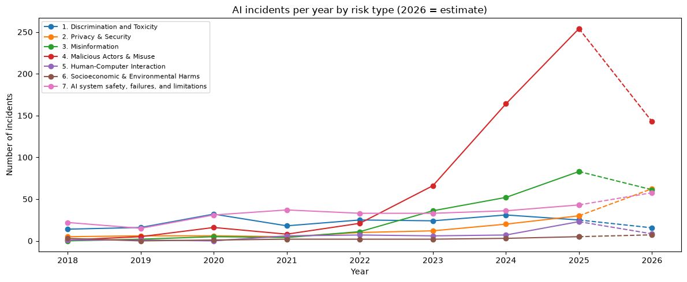

# AI Incident Early Warning

Can we spot early warning signs of AI harms, the same way we spot early warning signs of a crop disease
outbreak?

In my earlier projects I predicted Turcicum Leaf Blight in maize from weather data
([tlb-prediction-v2](https://github.com/thepratimabaral/tlb-prediction-v2)) and found a maize disease
model that was looking at the background instead of the disease
([agro-vision-xai](https://github.com/thepratimabaral/agro-vision-xai)). Here I use the same kind of
thinking on real AI incidents: which kinds of AI harm are growing, and can we trust what the data shows?

This is a first version. It is not finished research.

## Data

[AI Incident Database](https://incidentdatabase.ai) (AIID), snapshot of 2 November 2026:

- 1,786 incidents (1983 to October 2026), each with a date, title and description
- 1,498 of them have a risk type from the
  [MIT AI Risk Repository](https://airisk.mit.edu) (7 types, for example Misinformation or Malicious
  Actors & Misuse)

## What I found

### 1. AI incidents are growing fast, mostly misuse

<p align="center"></p>

The number of incidents went from 91 in 2020 to 463 in 2025, about 5 times more.

But not every type is growing. Malicious Actors & Misuse (people using AI to harm others on purpose)
went from 20 in 2022 to 237 in 2025, about 12 times more. Most of these are fraud and scams with
deepfake videos and cloned voices. AI system failures and discrimination stayed about the same (around
25-37 per year).

<p align="center"></p>

**Is this real, or just more reporting?** If it was only because more people report AI incidents now, I
would expect all types to go up together. They don't. So something probably really changed after 2022,
when image, video and voice generators became easy to use. But this is a clue, not proof: the news may
also write more about deepfakes than about other harms.

### 2. Recent incidents are missing their risk type

| Year | Incidents with a risk type |
|---|---|
| 2015-2021 | 98-100% |
| 2024 | 94% |
| 2025 | 89% |
| 2026 | 34% |

So any trend by type for 2026 looks like a big drop, but it is only because the labelling has not caught
up yet.

### 3. A model can fill in the missing types, but the past is a bad guide

I trained a model that reads an incident's description and predicts its risk type. I split by year
(train up to 2023, validation 2024, test 2025-2026), not randomly, because similar incidents happen
close together in time and a random split gives too good results.

| Model (trained up to 2023, tested on 2025+) | Accuracy | Macro F1 |
|---|---|---|
| Always guess the most common type | 9.8% | 0.03 |
| TF-IDF + Logistic Regression | 69.8% | 0.45 |
| Sentence embeddings (model2vec) + Logistic Regression | 68.2% | 0.49 |
| Embeddings, trained up to 2024 | 74.5% | 0.55 |

- The simple baseline is very bad (9.8%) because the mix of types changed: in the training years the
  most common type was AI system failures (33%), but in 2025+ it is misuse (56%).
- Adding 2024 to the training data helps a lot, so the model needs to be retrained often.
- The model mixes up Misinformation and Misuse a lot. Part of this is the labels themselves: a deepfake
  video of a politician is both.
- Very small types (Socioeconomic & Environmental Harms, 15 training examples) are never predicted
  correctly.

<p align="center"></p>

### 4. The model is not using obvious shortcuts

Like in my maize project, I checked what the model is actually using:

- **Hiding company and product names** (ChatGPT, Tesla, Google...) and retraining: accuracy 69.8% →
  70.4%. So it doesn't depend on names.
- **Removing the word "deepfake"** from 149 test incidents: only 5 predictions changed. So it
  understands misuse from other words too (voice, video, fake).

But I found something else: for Human-Computer Interaction, the top words in the training years are
*driver, vehicle, tesla, delivery*. In 2025 these incidents are mostly about chatbots and mental health.
The same label now describes a different kind of harm (concept drift).

### 5. 2026 still looks too low

<p align="center"></p>

After filling in the missing types with the model, 2026 (full-year estimate) still looks lower than
2025, for example misuse 254 → 143. I don't think this is a real drop. Incidents are often added to the
database weeks or months after they happen, so many 2026 incidents are probably not in it yet.

## What I want to do next

- **Correct for late reporting (nowcasting).** The AIID publishes a snapshot every week. By comparing old
  snapshots I can measure how long incidents take to be added and estimate the real recent numbers,
  the same way epidemiologists correct case counts during an outbreak.
- **Correct for reporting bias** by adding other sources (OECD AI Incidents Monitor, AIAAIC) and data on
  AI model releases (Epoch AI).
- **Build and test an early warning:** would a method like this have warned about the rise in deepfake
  scams before 2023?

## Limitations

- The AIID only has incidents that someone reported, mostly from English-language news.
- Titles often say "allegedly" or "reportedly", so many incidents are not confirmed.
- The predicted risk types are only right about 70% of the time, and much less for small types.
- 2026 is only 10 months of data.

## Files

- `01_explore.ipynb` - first look at the data: incidents per year, by type, missing labels
- `02_classifier.ipynb` - risk type classifier, shortcut checks, filling in missing labels
- `assets/` - charts used in this README
- `data/` - put the AIID snapshot here (not uploaded)

## How to run

1. Download the newest snapshot from https://incidentdatabase.ai/research/snapshots/ , put it in
   `data/` and unzip it: `tar -xjf backup-*.tar.bz2`. Results may differ a bit from mine with a newer
   snapshot.
2. Then:

```bash
python3 -m venv .venv
source .venv/bin/activate
pip install -r requirements.txt
jupyter notebook
```

The embedding model (`minishlab/potion-base-32M`) is downloaded from Hugging Face the first time. I use
model2vec instead of sentence-transformers because PyTorch doesn't support Intel Macs any more.

## Data credit

McGregor, S. (2021) Preventing Repeated Real World AI Failures by Cataloging Incidents: The AI Incident
Database. IAAI-21.
